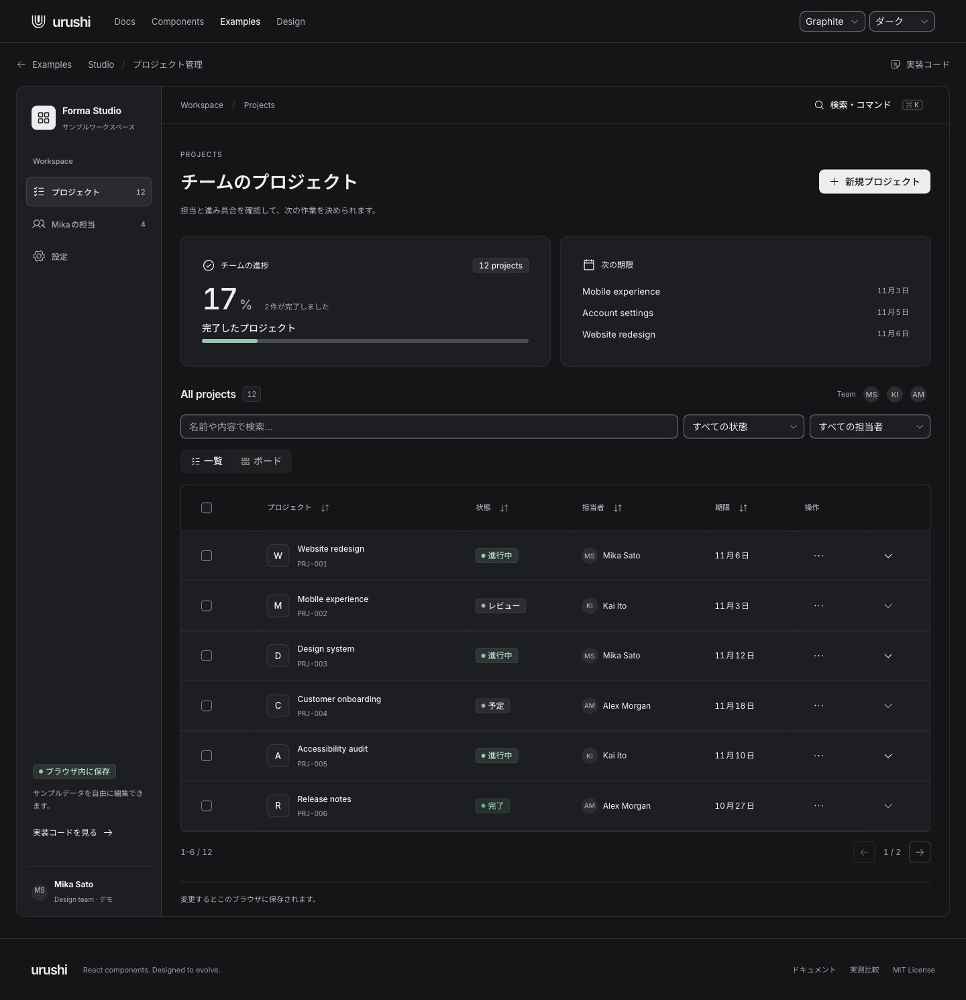
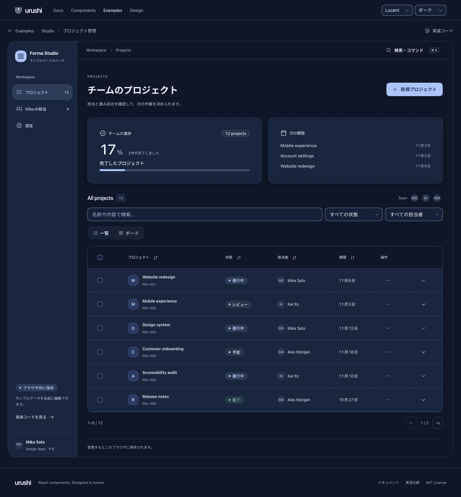
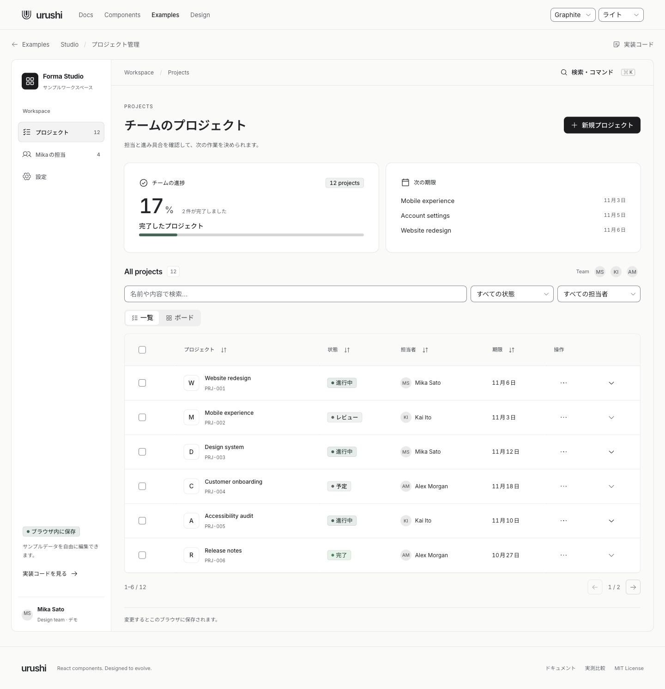
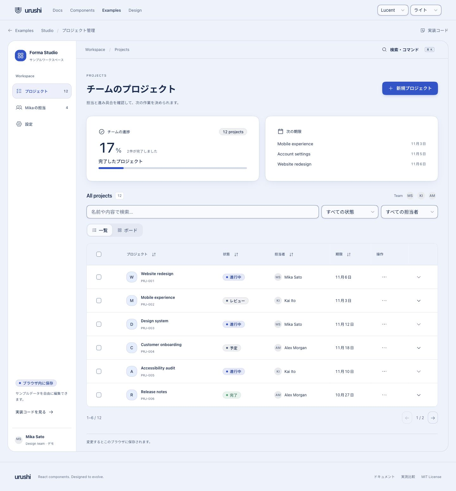

# パックのデザイン改訂

2026-10-30

GraphiteとLucentは操作部の高さや文字の太さが同じで、Studioにも角丸や余白の固定値が残っていました。Lucentの共通トークンを見直し、アプリとコンポーネントがその設定に従うようにしました。

| 項目 | Graphite | Lucent |
| --- | --- | --- |
| 色 | 無彩色を中心に構成 | 青い背景と白い面。ダークでは濃紺と青みのある面 |
| 標準コントロールの高さ | 36px | 42px |
| 通常の角丸 / カード | 8px / 12px | 14px / 24px |
| 操作部 / 見出しの太さ | 500 / 600 | 600 / 700 |
| 影 | 輪郭を中心とする控えめな影 | 青みを帯びた影で面の重なりを表現 |
| 通常の反応 / パネル開閉 | 120ms / 160ms | 180ms / 260ms |

スクワークル対応ブラウザでは、各パックの専用半径を使います。Graphiteのトークンは変更していません。

Studioのナビゲーション、見出し、カード間の余白、プロジェクトのアイコン背景を共通トークンに接続しました。担当者フィルターの文字が折り返さない幅を確保し、狭い画面ではフィルターを縦に並べます。

ComboboxとDatePickerの入力欄、候補、カレンダー、Commandにもパックの高さ・角丸・文字・開閉時間を適用しました。DataTableには面の色を指定し、背景から区別しやすくしました。生成CSSと別アプリのStudio用CSSも更新しています。

## 確認した内容

- Chromium・Firefox・WebKitでLucentの52コンポーネントをライト・ダークの両方で確認しました。axeの対象違反はなく、320px幅でプレビューのはみ出しもありませんでした。両パックのDialog・AlertDialog・Sheet・Popoverの操作も通っています。記録は `pack-design/detail-audit.log` です。
- 入力欄の追加調整後、Studioと4つの状態を持つコンポーネントの51ケースを確認しました。48ケースが通り、新規テスト3ケースは「必須」を含むラベルの指定が原因で停止しました。テストの対象指定を修正し、3ブラウザで再実行して通っています。記録は `studio-and-controls.log` と `pack-identity.log` です。
- パックを切り替えたときに実際の寸法・文字の太さ・影・動作時間が変わること、検索内容と行選択が保たれること、再読み込みしても選んだパックが残ることを検証しました。
- Lucentのプロジェクト名・担当者・期限の入力欄が同じ高さになることと、320px幅のカレンダーの収まり・アクセシビリティを検証しました。
- トークンの5テスト、CSS抽出の3テスト、型検査、lint、サイトと別アプリのStudioのビルドが通っています。
- 実際のブラウザでも、テーマ切り替え、一覧とボード、Checkbox、担当者検索、カレンダー、編集の取消を操作しました。1440px・390px・320px幅を確認しています。保存データは変更していません。

今回はデスクトップのブラウザと幅の変更による検証です。iPhone・Android実機での再検証は行っていません。

サイトのビルドには、既存の `::scroll-button` などのCSS構文をTurbopackが認識しない警告が12件残っています。今回変更した箇所の警告ではありません。

## 比較画像

| Graphite | Lucent |
| --- | --- |
|  |  |
|  |  |

モバイル幅のボード、編集画面、カレンダーも `pack-design/` に保存しています。
