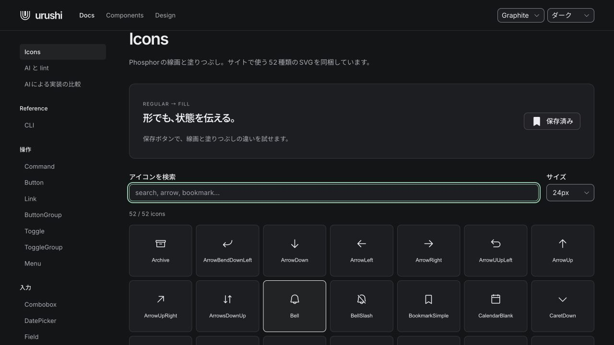
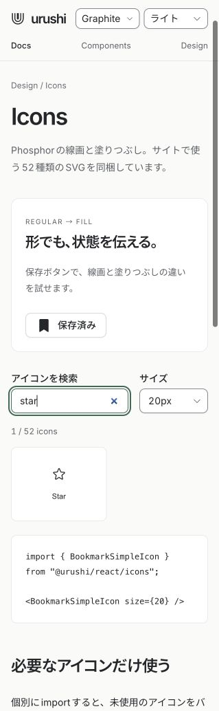
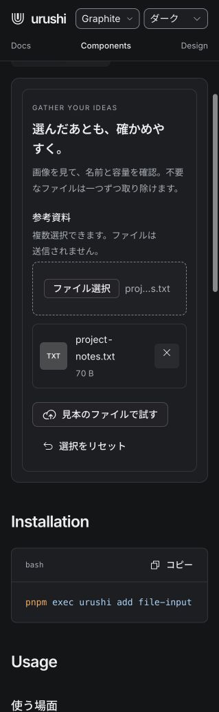
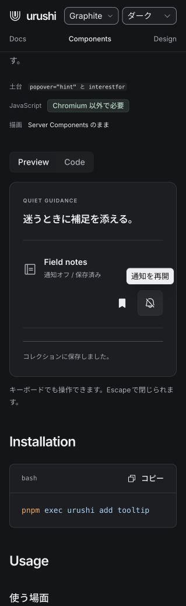

# Phosphor Icons 導入記録

2026-10-29

Phosphorの公式SVGを、サイトの操作アイコンとコンポーネントの標準アイコンに採用した。
確認用ページ: http://localhost:3200/docs/icons/

## 実装

- `@phosphor-icons/core@2.1.1` の52種類・60SVGを同梱。8種類はRegular / Fillの切り替えに対応。
- `@urushi/react/icons` から個別にimportできる。サイズは16・20・24px、色は `currentColor`。
- 装飾アイコンは既定で読み上げを省略し、名前を付けたアイコンは画像として扱う。アイコンだけのボタンはボタン側に名前を付ける。
- 保存・お気に入り・ナビゲーションの選択状態を、線画と塗りつぶしでも伝える。
- Combobox、DatePicker、DataTable、Carousel、Commandと、CSSの標準アイコンを更新。サイトの一覧・詳細のサンプルにも適用。
- Checkbox固有の描画アニメーションは維持。ロゴや説明用の図は置き換えていない。
- Iconsページに検索、サイズ選択、importコード、保存状態の操作例、ライセンスを追加。
- モバイルのTooltipサンプルは保存・通知ボタンを同じ操作グループにまとめ、44pxの操作領域を確保。

Phosphorのnpm実行用パッケージやCDNへの依存は追加していない。既存のReact等への依存は残る。
公式SVGを `packages/react/assets/phosphor/` に保存し、`manifest.json` に配布元・バージョン・整合性情報を記録した。
`scripts/build-phosphor-icons.ts` は各SVGのSHA256を確認してReactとCSSを生成する。通常の生成処理はネット接続を必要としない。

MITライセンス全文をソース、CSS、サイト、`THIRD_PARTY_NOTICES.md` に収録した。
リリース処理にも通知ファイルの同梱を追加した。今回、npm公開や配布用tarballの再作成は行っていない。

## 検証

- 型検査、lint、生成、サイト本番ビルド: 通過。
- 単体テスト: 291件を検証。初回290件通過。残り1件はライセンスコメントを外部importと誤判定するテストを修正し、関連3件の再実行で通過。
- ブラウザ回帰検証: 重複を除く141件（コントロール57件、サイト84件）の最新結果は全件通過。Chromium / Firefox / WebKitで実行。
- 52詳細ページ・52一覧プレビューの表示、Graphite / Lucentとライト／ダーク、狭い画面、関連コンポーネントの操作、強制色、reduced motionを対象に検査。
- Iconsページは検索・サイズ・選択・キーボードでの保存切り替えに加え、320px / 1280pxとライト／ダークの4条件でaxe検査を通過。
- 新しいIcons検査では、色の遷移中に計測していた箇所に遷移終了待ちを追加。4条件を一つのテストで回すと時間制限にかかったため、条件別のテストに分割した。最終15件はすべて通過。
- ブラウザを実際に操作し、Iconsの検索・サイズ・保存、FileInputの見本選択と削除、Tooltipの保存・通知を確認した。今回の実機iPhone / Android確認は行っていない。
- リリース用TypeScriptのコンパイルと、IconsのJS・型定義の出力を確認した。

詳細な結果とログは `phosphor/validation.json` と同じフォルダのログに保存した。

## サイズ

`pnpm size` のgzip実測。Reactは外部扱い。個別gzipサイズの単純合算は配信サイズを表さない。

| 対象 | gzip |
| --- | ---: |
| Button + Dialog + Popover | 1.09 KB |
| Dialog / Popover / Menu / Select / Tabs / Tooltip + runtime | 13.73 KB |
| 52コンポーネントのJS | 19.17 KB |
| 全runtime | 11.62 KB |
| 全コンポーネントCSS | 18.28 KB |
| Graphiteパック | 1.18 KB |

52種類のアイコン一覧を全アプリへ自動で含める構成にはしていない。
個別importで未使用アイコンが除外され、外部importがReactだけになることを単体テストで確認した。

## 画面

